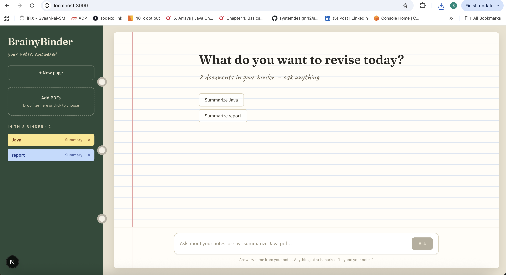
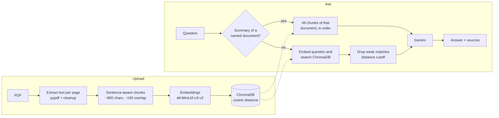

# BrainyBinder

**Your notes, answered.** BrainyBinder is a personal study assistant: upload your PDFs, then ask questions about them in plain English. Answers come from your own notes, with the exact document and page they came from.



## Features

- **Ask across all your notes.** No need to say which document; BrainyBinder searches everything you've uploaded.
- **Cited answers.** Every answer shows its sources as tabs (document + page). Click a tab to see the exact passage.
- **Full-document summaries.** "Summarize Java.pdf" reads *every* section of the document, not just a few matching passages. Summaries are cached, so asking again is instant.
- **Follow-up questions.** "Explain that more simply" works, because recent conversation is sent with each question.
- **Honest about gaps.** If your notes don't cover a question, it says so. Any general explanation is clearly separated under **"Beyond your notes"**.
- **Resilient to API problems.** Bounded timeouts, controlled retries and an automatic fallback model; if the AI service is busy, you get a clear message instead of a crash.
- **Notebook-style chat UI.** A binder with color-coded document tabs, drag-and-drop PDF upload, and a lined-paper conversation view.

## How it works



1. **Ingestion:** each PDF is read page by page, cleaned (including re-joining words split by line-end hyphens), and split into overlapping chunks on sentence boundaries. Each chunk is embedded and stored in ChromaDB with its file name, chunk number and page.
2. **Questions:** the question is embedded and matched against all chunks. Matches above a distance cutoff are discarded, so unrelated notes never reach the model. The remaining chunks, plus the last few conversation turns, are sent to Gemini with instructions to answer from the notes first.
3. **Summaries:** when a question asks to summarize a named document, BrainyBinder skips search and sends every chunk of that document, in order. Very long documents are summarized section by section, then combined. The result is cached on disk.

## Tech stack

| Layer | Technology |
|---|---|
| Frontend | Next.js (App Router), React, TypeScript, Tailwind CSS |
| Backend | Python, FastAPI, Uvicorn |
| Vector store | ChromaDB (persistent, cosine similarity) |
| Embeddings | Sentence Transformers, `all-MiniLM-L6-v2` (384 dimensions, runs locally) |
| LLM | Google Gemini API (`google-genai`) |
| PDF parsing | pypdf |

## Project structure

```
brainybinder/
├── app.py                  # FastAPI app: /query, /upload, /documents
├── config.py               # All settings (models, chunk size, cutoffs, paths)
├── ingest.py               # Re-index every PDF in data/
├── requirements.txt
├── .env.example            # Copy to .env and add your API key
├── services/
│   ├── pdf_loader.py       # Page-by-page text extraction
│   ├── text_cleaner.py     # Whitespace and hyphenation cleanup
│   ├── chunker.py          # Sentence-aware chunking with overlap
│   ├── embedder.py         # Batched sentence-transformer embeddings
│   ├── vector_store.py     # ChromaDB storage and search
│   ├── retriever.py        # Search + relevance cutoff
│   ├── document_matcher.py # Detects named documents and summary requests
│   ├── summarizer.py       # Full-document summaries with caching
│   ├── document_service.py # Indexing pipeline
│   └── llm.py              # Gemini calls, retries, fallback, prompts
└── frontend/
    ├── app/                # page.tsx (chat), layout.tsx (fonts)
    ├── components/         # Binder, MessageCard, Composer, theme
    └── lib/api.ts          # Backend API client
```

Generated at runtime and not committed: `data/` (uploaded PDFs), `vector_store/`, `summaries/`.

## Getting started

### Prerequisites

- Python 3.10+
- Node.js 18+
- A Gemini API key from [Google AI Studio](https://aistudio.google.com/)

### 1. Backend

```bash
git clone https://github.com/shreya106/brainybinder.git
cd brainybinder

python -m venv venv
source venv/bin/activate          # Windows: venv\Scripts\activate
pip install -r requirements.txt

cp .env.example .env              # then put your key in .env
```

Minimal `.env`:

```
GEMINI_API_KEY=your-key-here
GEMINI_MODEL=gemini-flash-latest
GEMINI_FALLBACK_MODEL=gemini-flash-lite-latest
```

Start the API (it runs on http://127.0.0.1:8000):

```bash
python -m uvicorn app:app --reload
```

Optional: to index PDFs you've placed in `data/` directly, run `python ingest.py`.

### 2. Frontend

In a second terminal:

```bash
cd frontend
npm install
npm run dev
```

Open http://localhost:3000, add a PDF in the binder, and start asking.

## Configuration

All settings live in `config.py`; the ones you're likely to change can be set in `.env`.

| Setting | Default | What it does |
|---|---|---|
| `GEMINI_MODEL` | (required) | Main model for answers and summaries |
| `GEMINI_FALLBACK_MODEL` | none | Used automatically when the main model is overloaded or out of quota |
| `GEMINI_THINKING_BUDGET` | unset | `0` disables "thinking" on models that support it, for faster answers |
| `LLM_TIMEOUT_SECONDS` | 30 | Max wait for an answer before trying again or falling back |
| `ALLOW_GENERAL_KNOWLEDGE` | true | `false` = answers strictly from your notes |
| `CHUNK_SIZE` / `CHUNK_OVERLAP` | 900 / 150 | Characters per chunk and carried-over context |
| `TOP_K` | 5 | Chunks retrieved per question |
| `MAX_DISTANCE` | 0.65 | Relevance cutoff (lower = stricter) |

## API

| Method | Endpoint | Description |
|---|---|---|
| `POST` | `/query` | `{ "question": "...", "history": [{ "question", "answer" }] }` → `{ answer, mode, sources }` |
| `POST` | `/upload` | Multipart PDF upload; indexes it immediately |
| `GET` | `/documents` | Lists indexed documents |
| `DELETE` | `/documents/{filename}` | Removes a document, its index entries and its cached summary |

Interactive docs are available at http://127.0.0.1:8000/docs while the backend is running.

## Engineering notes

Problems found while testing, and how they were fixed:

- **2–3 minute responses.** The Gemini SDK was silently retrying "model overloaded" errors. Replaced with a hard timeout, at most two attempts, and an automatic fallback model; quota errors skip straight to the fallback.
- **Duplicate chunks.** The old chunker could carry an oversized sentence into every following chunk. Long sentences are now split, and overlap is capped by characters.
- **Incomplete summaries.** Summaries used to come from the top 20 search matches, so whole sections were missing. They now read every chunk in order.
- **Irrelevant context.** Search always returned a fixed number of chunks, however unrelated. A cosine-distance cutoff now filters weak matches, which is also what allows an honest "not in your notes".
- **Broken words from PDFs.** Line-end hyphenation ("pro- cessed") is re-joined before chunking.

## Limitations

- PDFs only, and they need a text layer (scanned images aren't OCR'd yet).
- Broad questions such as "what are the key ideas in my notes?" may not match any single passage; use a document's **Summary** button for overviews.
- Designed as a single-user local app (no accounts or authentication).
- The Gemini free tier has a small daily request limit per model.

## Roadmap

- [ ] Streaming answers (text appears as it's generated)
- [ ] Answer broad questions from cached document summaries
- [ ] Save typed or pasted text as a note
- [ ] OCR for scanned PDFs
- [ ] Retrieval evaluation set with accuracy metrics
- [ ] Deployment with a public demo link

## Author

Built by **Shreya Galurgi**.
